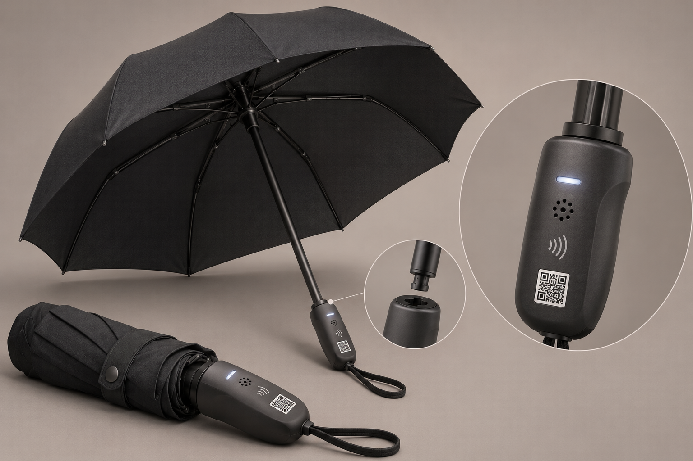
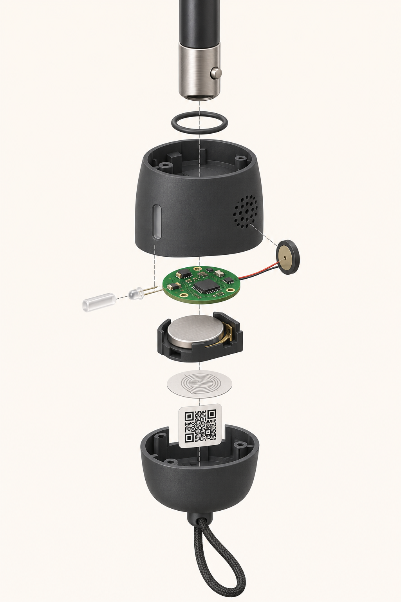
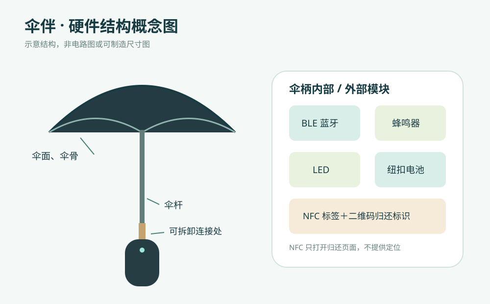

# 硬件原型设计说明

## 新版整伞原型与伞柄爆炸图

新版两图由内置 imagegen 生成，均为概念渲染。图中的二维码是视觉占位，**不能扫描用于真实归还**。爆炸图表达部件组成与大致装配顺序；PCB 布线、接头锁止、密封圈尺寸、电池更换方式及防水等级均未完成工程验证。

生成提示词摘要：`realistic product render of folding smart umbrella with detachable handle, LED, buzzer grille, NFC and QR return sticker`；`isometric exploded view of smart umbrella handle with detachable shaft connector, O-ring, BLE PCB, piezo buzzer, LED, coin cell, passive NFC sticker, QR sticker and lower shell, no motor or GPS`。

## 原版概念图与结构示意

上图为 AI 生成的**外观概念渲染**，只用于展示设计方向；连接器尺寸、材料、内部空间和防水性能未经工程验证。生成提示词：`realistic studio render of a compact folded black umbrella and detachable matte charcoal ergonomic handle; discreet LED, NFC tap symbol, small speaker port; inset open umbrella; no text or watermark`。生成方式：内置 imagegen。

## 部件与作用

| 部件 | 作用 | 设计注意点 |
| --- | --- | --- |
| 伞面、伞骨、伞杆 | 挡雨与支撑 | 优先保证正常雨伞的强度、开合和重量 |
| 可拆卸伞柄 | 容纳电子模块 | 连接处要抗松动、防进水 |
| BLE 低功耗蓝牙模块 | 近场连接、分离检测 | 无法独立提供实时 GPS 位置 |
| 蜂鸣器、LED | 近场找伞时发声发光 | 声量、耗电和防水需实测 |
| 纽扣电池/电池仓 | 供电 | 续航需要根据发射频率与实际使用测试 |
| NFC 标签＋二维码 | 拾获者打开归还页 | NFC 不会主动发射位置；二维码作为兼容入口 |

## 数据流

伞柄 BLE → 手机检测连接状态 → 手机在分离时记录自身位置 → 用户查看最后出现位置。天气提醒则需要天气服务与手机通知权限。此图没有表达已完成的电路板、PCB 或量产结构。
